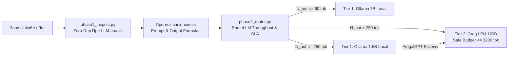

# 📊 Емпіричний кейс-стаді: 1225 кроків та 12.8 діб безперервної сесії (`ee6e8ead`)

## 1. Паспорт емпіричного рекорду сесії `ee6e8ead`

| Параметр | Значення та метрики | Інженерні примітки |
| :--- | :--- | :--- |
| **Ідентифікатор сесії (UUID)** | `ee6e8ead-ba3b-4489-814f-d04ffdd435d6` | Зафіксовано в системному реєстрі транскриптів |
| **Часовий інтервал** | `2026-10-02T13:46:27Z` $\rightarrow$ `2026-10-15T09:27:07Z` | **307 годин 40 хвилин** (**12.82 діб** безперервно) |
| **Загальний лічильник кроків** | **1225 кроків взаємодії** | Абсолютний рекорд життєвого циклу в системі |
| **Кількість запитів користувача** | **79 прямих звернень (`USER_INPUT`)** | Повноцінна розробка, архітектурний дизайн, кодинг |
| **Обсяг журналу транскрипту** | `transcript_full.jsonl`: **15.26 МБ** `transcript.jsonl`: **2.97 МБ** | 550+ викликів інструментів |
| **Події компакції контексту** | **236 подій урізання (`truncated_fields > 0`)** | Автоматичний захист контекстного вікна рушієм IDE |
| **Цілісність даних Git** | **0 деструктивних операцій (`reset`/`revert`)** | 100% збереження файлів та комітів |
| **Історична подія сесії** | **Народження репозиторію `Hybrid-IDE`** | Створено на кроках `#789`–`#839` (11 жовтня 2026) |

---

## 2. Порівняльна матриця 4-х довгоживучих сесій Hybrid IDE

| Параметр / Метрика | Сесія 1 (`ee6e8ead`) **Абсолютний рекорд** | Сесія 2 (`c80fdbd3`) **Стрес-тест 6 діб** | Сесія 3 (`c9ce18b5`) **Стабілізація політики** | Сесія 4 (`80b38d99`) **Axient Systems B.V.** |
| :--- | :---: | :---: | :---: | :---: |
| **Тривалість** | **12.82 діб** (307 год) | **5.80 діб** (139 год) | **1.20 діб** (29 год) | **Активна паралельна** |
| **Кількість кроків** | **1225 кроків** | **822 кроки** | **198 кроків** | **64 кроки** (Фаза 3 Approval) |
| **Розмір логу (Full)** | **15.26 МБ** | **2.38 МБ** | **1.10 МБ** | **0.45 МБ** |
| **Compaction Events** | **236 подій** | **148 подій** | **18 подій** | **2 події** |
| **Ключова діяльність** | Народження `Hybrid-IDE`, Fallaut4 modding, архітектурний бенчмарк 93.3% | CSIS доктрина дронів Китаю, досьє експертів, UWE, міграція `/bridge` | Стабілізація 34/34 правил, Multi-Project Symlink Mesh, Hard Gates | Заявка Mission/System Architect (Delft), LEO FMV Sliced Intra-Refresh |
| **Статус регламенту** | PARTIAL COMPLIANCE (стартувала до шлюзів v0.8) | FULL PASS (арбітраж Claude Sonnet 5.5) | FULL PASS (34/34 валідатор 0.0с) | FULL PASS (суворе дотримання Фази 2/3) |

---

## 3. Анатомія виявлених дефектів та їхнє усунення

### 1) Чому виникав виклик `ls` замість Git-First і чому він давав порожній результат?
- **Причина 1 (LLM Muscle Memory):** Велика мовна модель під час широких дослідницьких запитів за замовчуванням генерує базові команди POSIX (`ls -la`, `dir`).
- **Причина 2 (Прогалина перехоплювача):** У первинній версії `pre_tool_hook.py` команди `list_dir` та `find_by_name` блокувалися, але для `run_command` рядок `ls` був помилково включений у `trusted_host_prefixes`.
- **Причина 3 (Ізоляція пісочниці):** Запуск `ls` у пісочниці без `BypassSandbox: true` виконувався у відокремленому неймспейсі, де шляхи хоста `/home/hills/Documents` відсутні, тому команда повертала порожній результат.
- **Вирішення (Директива 1):** `ls` вилучено з довірених команд. Впроваджено жорсткий **Hard Deny Gate**, який негайно блокує `ls` / `dir` з кодом відмови та перенаправляє на атомарні буфери Git (`git status -sb`, `git ls-files`, `git show HEAD:<файл>`).

### 2) Чому користувач отримував лавину модальних запитів «Always Allow»?
- **Причина 1 (Порушення форми префікса):** Кеш дозволів «Always Allow» у платформі Antigravity базується на суворому зіставленні префіксів (`prefix-matching`). Виклики з динамічними іменами файлів у `scratch/` або чергування відносних (`.agents/scripts/...`) та абсолютних (`/home/hills/Documents/.agents/scripts/...`) шляхів зривали авто-схвалення.
- **Причина 2 (Штучний prompt у хуку):** У `pre_tool_hook.py` правило для операцій запису встановлювало `needs_prompt = True` для будь-яких файлів поза `workspacePaths`. Оскільки активний воркспейс був `Hybrid-IDE-for-contributors`, запис будь-якого конфігу в хост або артефакту в `brain` викликав модальне вікно та звук `access_request.wav`.
- **Вирішення (Директива 2):** До списку довірених просторів запису додано `/home/hills/Documents` та `/home/hills/.gemini/antigravity/brain`. Зафіксовано єдину канонічну абсолютну форму виклику раннера.

---

## 4. Штатний тулсет оцінки контексту (Upstream References)

Замість написання одноразових ad-hoc скриптів закріплено штатний контур оцінки ваги контексту на основі open-source стандартів ([`docs/architecture/upstream_reference_models.md`](../docs/architecture/upstream_reference_models.md)):

1. **`core/inspect/phase1_inspect.py` (Pre-LLM Format Inspector):**
   - `--json`: швидка оцінка розмірностей, списків та ключів без вичитування гігабайтів у пам'ять моделі.
   - `--ast`: статичне синтаксичне дерево без виконання коду.
   - `--docx` / `--xml`: читання параграфів і коментарів без офісних пакетів.
2. **`core/router/phase2_router.py` (RouteLLM Throughput & SLA Router):**
   - Розрахунок $\text{ETC} = \text{TTFT} + \frac{N_{\text{out}}}{V_{\text{model}}}$ при $\text{SLA} \le 30.0$ с.
   - Оцінка ваги промпта: $\text{Prompt Tokens} = \text{int}(\text{len}(\text{prompt.split}()) \times 1.3) + 150$.
   - **LiteLLM Safe Budgeting (-20% Margin):** жорсткий поріг $\le 6400$ TPM, $\le 800$ RPM, $\le 3200$ токенів на вивід для Groq Cloud LPU.
3. **`core/engine/diagnostic_runner.py` (FrugalGPT Cascade Conductor):**
   - Прямий інференс до локальної Ollama $\to$ перевірка синтаксису через `ast.parse()` $\to$ автоматичний failover на Groq 120B при виникненні `SyntaxError`.
   - Виправлено дефект хибного збою API при наявності `[ERROR]` у валідному коді (перевірка `raw_cloud.startswith("ERROR:")`).
4. **`inspect_session.py` (Session Log Forensics):**
   - Потоковий збір метрик із транскриптів сесій без завантаження повного JSONL у контекстне вікно діалогу.
