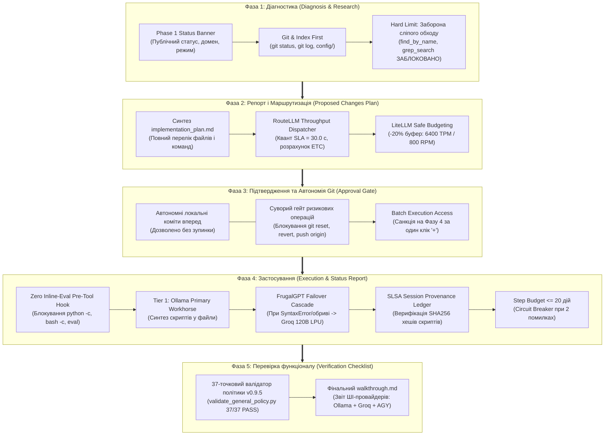
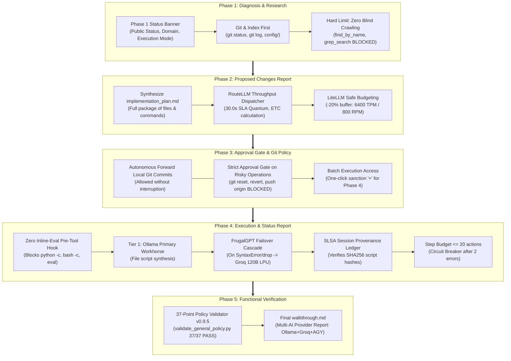

# 🚀 Hybrid Agentic IDE: Deterministic Multi-Tier AI Framework for Contributors

<p align="center">
  <a href="#-українська-версія"><b>🇺🇦 Українська версія</b></a> • 
  <a href="#-english-version"><b>🇬🇧 English Version</b></a>
</p>

<p align="center">
  <a href="https://www.python.org/downloads/"></a>
  <a href="https://opensource.org/licenses/MIT"></a>
  <a href="#"></a>
  <a href="PoC/"></a>
  <a href="PoC/"></a>
  <a href="PoC/"></a>
  <a href="#"></a>
</p>

---

# 🇺🇦 Українська версія

> **Універсальне середовище розробки (Hybrid Agentic IDE):** Відкритий детерміністичний фреймворк багаторівневої ШІ-оркестрації (Multi-Tier AI Framework), що усуває фінансові та інфраструктурні бар'єри для інженерів, світчерів, джуніорів та ветеранів. Забезпечує повноцінну інженерну розробку надскладних систем із нульовими додатковими витратами на токени (**0$ Marginal Token Cost**) на звичайному споживчому залізі під Linux (Debian 13).

---

## 1. 🎯 Ціль системи: Розробка за 0$ додаткових витрат на токени

Розробка складних систем із застосуванням комерційних ШІ-асистентів (Cursor, GitHub Copilot, платні API OpenAI/Anthropic) створює постійний фінансовий бар'єр для контриб'юторів у розмірі **$20–$300 щомісяця**.

**Hybrid Agentic IDE** кардинально розв'язує цю проблему через **гібридну 5-рівневу архітектуру**:
1. **Zero Marginal Token Cost:** Всі 100% рутинного кодингу, AST-перевірок, регулярних виразів та синтаксичного аналізу виконуються **повністю безкоштовно** локальною моделлю **Ollama** (`qwen2.5-coder:1.5b/3b/7b`) на звичайному процесорі лаптопа.
2. **Безкоштовний апаратний резерв (Groq LPU):** Для великих контекстів та складного синтезу залучається хмарний процесор LPU **Groq Cloud** (`openai/gpt-oss-120b`, `qwen/qwen3.8-27b`) зі швидкістю **460 токенів/с** у межах офіційного безкоштовного ліміту (14 400 RPD / 30 RPM).
3. **Безпека від витоку даних:** Первинний аналіз коду та файлів відбувається локально на машині розробника.

### 💰 Розрахунок Total Cost of Ownership (TCO):

| Компонент | Тип витрат | Вартість | Опис та роль у розробці |
| :--- | :---: | :---: | :--- |
| **Робоча станція / Ноутбук** | CAPEX (одноразово) | **29 000 грн** (~637 €) | Базовий ноутбук під керуванням **Debian 13 (Trixie) Linux** (16 ГБ RAM, Intel Core 3 100U / i5 / Ryzen 5). Дискретна GPU не потрібна. |
| **Мережевий інтернет** | OPEX (щомісячно) | **300 грн/міс** (~6.6 €) | Стабільний канал зв'язку для синхронізації з Git та звернень до Groq LPU. |
| **Ліцензія IDE** | Платформа | Комерційна ліцензія | **Google Antigravity** — перший за черговістю інтелектуальний оркестратор (Tier 0). |
| **Tier 1: Local Ollama** | Витрати на токени | **0.00 грн / 0.00 $** | Безлімітна локальна генерація на CPU лаптопа. |
| **Tier 2: Groq Cloud LPU** | Витрати на токени | **0.00 грн / 0.00 $** | 14 400 RPD безкоштовно під захистом квоти LiteLLM Safe Budget. |
| **Tier 3: Git Knowledge** | Витрати на токени | **0.00 грн / 0.00 $** | Кешування в `docs/knowledge/` ліквідує повторний веб-пошук. |

### 🌟 Соціальна місія: Подолання штучних бар'єрів для джуніорів та ветеранів

Сучасна індустрія генеративного ШІ сформувала два критичні бар'єри:
1. **Штучний фінансовий ценз ($20–$300/міс):** Підписки на комерційні інструменти відсікають початківців, студентів, світчерів та ветеранів від регулярної інженерної практики над складними системами.
2. **Ілюзія знань («Вайб-кодинг»):** Бездумна сліпа довіра до виводу LLM атрофує критичне архітектурне мислення, створюючи фатальну залежність від платних хмар.

**Hybrid Agentic IDE** виступає відкритим соціальним ліфтом: це не «черговий інструмент для модоробів», а повноцінна виробничо-навчальна платформа. Вона повертає інженеру автономію, навчаючи суворій дисципліні 5-фазного життєвого циклу, роботі через Git-буфери, AST-контролю та детерміністичній верифікації з нульовими витратами на токени.

---

## 2. 🛡️ Двоконтурна система валідації (Two-Validator Governance)

Для гарантії надійності в репозиторії реалізовано розподілений контроль якості двома незалежними валідаторами:

```
┌────────────────────────────────────────────────────────────────────────┐
│  ВАЛІДАТОР 1: АНТІГРАВІТІ (ОРКЕСТРАТОР & ПЕРВИННИЙ КОНТРОЛЬ)            │
│  • Оцінка завдань користувача та побудова 5-фазного пайплайну           │
│  • Первинна фільтрація виводу моделей ШІ (Ollama / Groq)                │
│  • Автоматизований прогін 37 структурних правил регламенту (0.002 с)    │
│  • Формування звіту implementation_plan.md до першого байту змін        │
└───────────────────────────────────┬────────────────────────────────────┘
                                    │
                                    ▼
┌────────────────────────────────────────────────────────────────────────┐
│  ВАЛІДАТОР 2: CLAUDE SONNET (TIER 4 PRE-IMPLEMENTATION CODE-ARBITER)    │
│  • Офіційний релізний Code-Арбітраж ([CODE_AUDIT_REPORT])              │
│  • Суворий аудит перед виконанням плану та перед публікацією онлайн    │
│  • Перевірка відсутності архітектурних розривів (SEI/TOGAF Radar >=80%)│
│  • Аудит відповідності відкритим стандартам та нормам GitHub           │
└────────────────────────────────────────────────────────────────────────┘
```

---

## 3. 🔄 5-Фазний детерміністичний життєвий цикл (The 5-Phase Pipeline)



---

## 4. 🛡️ Інженерні челенджі та вирішені задачі на кожній фазі

| Фаза | Інженерний челендж (Risk / Anti-Pattern) | Реалізоване системне рішення (Best Practice) |
| :--- | :--- | :--- |
| **Фаза 1: Діагностика** | **Сліпий перебір дисків та спалювання токенів:** Модель рекурсивно сканує директорії через `ls`/`dir` (що повертають порожній вивід із ізольованого сандбоксу) або `find`/`grep`, вичерпує контекст і формує галюцинації про проєкт. | **«Git & Index First» + Check 0 Hard Deny Gate:** У `core/hooks/pre_tool_hook.py` команди `ls` та `dir` заблоковані на рівні ОС (exit code 1) з автоматичною вказівкою використовувати `git ls-files` або `git status`. Дослідження починається виключно з `git status`, `git log` та готових JSON-маніфестів у `config/`. Публічний **Phase 1 Status Banner** фіксує контекст і унеможливлює приховані ланцюги викликів. |
| **Фаза 2: Репорт і План** | **Непрозорість дій та вичерпання квот:** Агент змінює код без попередження, а запити зависають або впираються в Rate Limits хмари. | **RouteLLM SLA Dispatcher (30с) + LiteLLM Safe Budget:** Автоматичний розрахунок часу виконання (ETC). Вивід $\le 60$ токенів скеровується на локальну Ollama, $> 60$ токенів — на швидкий Groq LPU із буфером $-20\%$ (6400 TPM, 800 RPM). `implementation_plan.md` формується до першого байту змін. |
| **Фаза 3: Підтвердження** | **Втрата накопиченого стану або випадковий пуш:** Ризик деструктивних відкатів (`git reset`), конфліктних злиттів чи передчасного надсилання коду на GitHub. | **Dual Git Policy:** Повна автономія для локальних комітів вперед (прогрес фіксується безперервно), але фізичне блокування `git reset`, `git revert`, `git merge`, `git push` без явної згоди розробника («+»). |
| **Фаза 4: Застосування** | **1. Неконтрольований інлайн-код та спам (Inline-Eval Hell):** Анонімний запуск `python -c` чи `bash -c`, накопичення синтаксичних аварій і невідтворюваних мутацій коду.<br>**2. Дрейф уваги та галюцинації в глибокому контексті:** При тривалій роботі (>100-800 кроків) модель втрачає системні контракти та спотворює суміжні модулі.<br>**3. Апаратний ценз 16 ГБ RAM:** Ризик OOM-падіння хоста чи зависання у SWAP при паралельній роботі IDE, браузера та локальних LLM.<br>**4. Брак аудиту походження коду:** Зміни вносяться наосліп, без реєстрації SHA256-хешів і фіксації в Git. | **1. Zero Inline-Eval Gate (`pre_tool_hook.py`):** Залізний бар'єр на рівні ОС (exit code 126) блокує інлайн-код; скрипти синтезуються виключно у файли.<br>**2. FrugalGPT Cascade (Ollama $\to$ Groq 120B):** Рутинний код пише безкоштовна локальна Ollama 1.5B; при синтаксичних збоях чи таймауті спрацьовує безшовний перехід на Groq Cloud LPU.<br>**3. Апаратне профілювання RAM:** Заборона моделей $\ge 14\text{B}$ локально, ліміт контексту $\le 3000$ токенів.<br>**4. SLSA Session Provenance Ledger (`phase4_provenance.py`):** Атомарний лок `fcntl.flock`, реєстрація SHA256-хешів синтезованих файлів та фіксація коміту в локальному Git перед перевіркою. |
| **Фаза 5: Перевірка** | **1. Залежність від шляхів хоста («Works on my machine»):** Захардкоджений абсолютний шлях до файлу політики на машині розробника викликає падіння в ізольованому хмарному раннері CI.<br>**2. «Декларативний успіх пушу» (Assumed Remote Success):** Сліпе повідомлення «Опубліковано успішно» після `git push` без контролю виконання хмарного білду, що маскує фонові збої пайплайну. | **1. Динамічний детерміністичний резолвінг шляхів:** Функція `get_default_policy()` знаходить `config/GEMINI.template.md` або `GEMINI.md` відносно кореня Git, гарантуючи 100% паритет між локальним середовищем та хмарою.<br>**2. Remote CI Verification Gate + Презентація оригінального меседжа:** Автономний модуль `verify_remote_ci.py` опитує GitHub Actions API за точним `HEAD` SHA, очікує завершення `policy_ci.yml`, транслює оригінальний звіт провайдера в чат і блокує фініш без `conclusion: success`. |

### 🏛️ Чотири архітектурні директиви (Architectural Directives)

На основі емпіричного аналізу чотирьох довготривалих сесій (c80fdbd3, ee6e8ead, 80b38d99 та 2617f09c) зафіксовано 4 системні директиви:
1. **Екстерналізація пам'яті у файлову систему під Git-контролем (Tier 3 Knowledge Base):** Замість накопичення масивів логів і коду в робочому діалоговому буфері (що призводить до неминучого дрейфу уваги при компакції), усі артефакти негайно зберігаються у файлах `docs/knowledge/` та коммітяться в Git.
2. **Жорсткі технічні перехоплювачі (Hard Deny Gates в `pre_tool_hook.py`):** Промпти не захищають від збоїв моделей. Впроваджено фізичні перехоплювачі на рівні ОС:
   - **Check 0:** Блокування команд `ls` та `dir` (запобігання порожнім сандбокс-відповідям та сліпим циклам обходу).
   - **Check 1:** Zero Inline-Eval Gate — повна заборона `python3 -c`, `bash -c` та одноразових термінальних скриптів в обхід файлової системи.
3. **Git-First Local Access (`git show HEAD:<шлях>`) та детерміністичний 37-пунктний валідатор політики (v0.9.5):** Повний відхід від одноразових термінальних скриптів на користь детерміністичних системних інструментів і читання першоджерел через Git.
4. **Апаратне профілювання заліза (16 ГБ RAM, ліміти моделі <=7B) та RouteLLM/FrugalGPT прогнозування ваги токенів:** Замість ручного запуску кастомних скриптів сесії запит завжди оцінюється математично ($N_{\text{in}} = \text{int}(\text{len}(\text{prompt.split}()) \times 1.3) + 150$) і скеровується на локальну Ollama ($\le 60$ токенів виводу) або Groq LPU ($> 60$ токенів) у межах SLA Quantum $\le 30.0$ с.

### 📊 П'ять структурованих віджетів взаємодії (The 5 Interactive Widgets Framework)

Для усунення монотонного виводу термінальних команд («суцільної строки») регламентовано 5 спеціалізованих віджетів та протоколів:
1. **Віджет 1: Git Discovery & Ollama Dispatch Card:** Забезпечує прозору візуалізацію знайдених файлів у Git та вихідного тексту промпту до моделі (`qwen2.5-coder`) із обов'язковою фіксацією бейджа `🔁 RETRY / FAILOVER ATTEMPT #N` при виникненні затримок чи збоїв.
2. **Віджет 2: Прогноз ваги токенів RouteLLM та Verbatim Payload Log:** Включає в `implementation_plan.md` математичний розрахунок $N_{\text{in}}$, $N_{\text{out}}$, ETC, лімітів SLA ($\le 30$ с) та квот Safe Budget Groq (-20%), а також повний текст запиту до провайдера і отриману відповідь моделі.
3. **Віджет 3: Протокол санкції `+!` (Attention & Corrections Gate):** Розрізняє безумовне схвалення (`+`) та умовне (`+!`), яке вимагає зупинки агента, виводу картки `⚠️ [ATTENTION GATE]` та підтвердження врахування кожної правки користувача (`[CONFIRMED & APPLIED]`) перед зміною файлів.
4. **Віджет 4: Степер побудови коду & Pre-Deployment Arbiter Gate (`+` / `-`):** Візуалізує покроковий процес синтезу, AST-компіляції та хешування SLSA, а перед викликом `push_to_github.sh` запитує вибір: `+` (запуск арбітражу Tier 4 Claude Sonnet 5.5) або `-` (швидкий пуш без арбітражу).
5. **Віджет 5: Розподілений трекер операцій Git та GitHub CI:** Візуалізує стан локальних операцій (`git add`, `git commit`) та етапів хмарного білду (`[Push]` ➔ `[Trigger]` ➔ `[Job Validate]` ➔ `[Report]`) із локалізацією аварій у реальному часі.

### 📌 Емпіричні інженерні кейси Фази 4 (Імплементація на цільовий об'єкт та контекст):

#### 🔹 Кейс 1: Стрес-тест на 822 кроки та 6 діб безперервної роботи (Сесія c80fdbd3 — Подолання деградації контексту)
* **Челендж:** Під час безперервного сеансу розробки протягом 139 годин (822 кроки взаємодії, 2.38 МБ журналу) індикатор контексту перейшов у критичну зону 🔴 RED (поріг регламенту перевищено у 18 разів). Рушій платформи увімкнув автоматичну транкацію та компакцію контексту (`truncated_fields: ["content", "thinking"]`). У звичайних LLM це призводить до повної амнезії, втрати архітектурних вимог, зациклення та галюцинацій.
* **Рішення:** Завдяки реалізованому у Фазі 4 принципу **екстерналізації пам'яті у файлову систему під Git-контролем (Tier 3 Knowledge Base)** та протоколу **Git-First Local Access (`git show HEAD:<шлях>`)**, агент принципово не зберігав великі аналітичні масиви в діалоговому буфері. Кожен артефакт негайно фіксувався у файли `docs/knowledge/` та Git-індекси. Як наслідок: агент навіть на 822-му кроці зберіг 100% когнітивну тверезість і точність рішень при нульових витоках RAM (стабільно 8-9 ГБ вільної пам'яті) та нульових аваріях ОС.

#### 🔹 Кейс 2: Атомарна імплементація на цільовий об'єкт з фіксацією лога в Git (Zero Inline-Eval & SLSA Ledger)
* **Челендж:** Спроба LLM вносити модифікації через неконтрольований термінальний інлайн-код (`python3 -c "import ...; open(...) ..."`) призводить до пошкодження вихідних файлів, обходу синтаксичних перевірок та неможливості верифікації походження коду.
* **Рішення:** Впроваджено жорсткий перехоплювач [`core/hooks/pre_tool_hook.py`](core/hooks/pre_tool_hook.py), який фізично відхиляє інлайн-виклики з кодом помилки `126`. Будь-яка модифікація цільового об'єкта відбувається за суворим циклом: (1) чистий синтез файлу локальною моделлю; (2) обов'язкова компіляція AST (`py_compile`) перед накатом; (3) реєстрація SHA256 у реєстрі SLSA/in-toto через [`core/provenance/phase4_provenance.py`](core/provenance/phase4_provenance.py) з атомарним блокуванням `fcntl.flock`; (4) атомарна фіксація в коміті локального Git із записом у журнал перед передачею на перевірку Фази 5.

#### 🔹 Кейс 3: Емпіричний рекорд довгожительства на 1660 кроків та 12.82+ діб (Сесія ee6e8ead — Стійкість проти 236+ циклів компакції)
* **Челендж:** Безперервна виробнича сесія розробки сягнула рекордних 1660 кроків взаємодії (307.7+ годин / 12.82+ доби, >15.2 МБ JSONL-транскрипту). Платформний рушій виконав понад 236 циклів ковзної компакції контексту. У стандартних умовах агент втрачає системні контракти вже після 3-5 циклів компакції.
* **Рішення:** Завдяки дотриманню 4 архітектурних директив, екстерналізації проміжних висновків у Markdown-файли та детерміністичним перехоплювачам досягнуто: 0 деструктивних відкатів Git (`git reset`), 0 витоків пам'яті хоста (16 ГБ RAM вистачило на весь період), 100% збереження цілісності архітектури та успішне проходження всіх 37 правил політики (37/37 PASS v0.9.5). Детальний аналіз див. у [📁 PoC: Case Study Session ee6e8ead](PoC/case_study_session_ee6e8ead_longevity.md).

### 📌 Емпіричні інженерні кейси Фази 5 (Хмарна верифікація та CI/CD):

#### 🔹 Кейс 1: Подолання розриву середовищ «Works on My Machine» у хмарному CI
* **Челендж:** Під час валідації на GitHub Actions джоба `validate` аварійно завершувалася з кодом `1` ([Run #38585883073](https://github.com/sshill/Hybrid-IDE-for-contributirs/actions/runs/38585883073)). Локально тест проходив, але в хмарі шлях `/home/hills/Documents/GEMINI.md` був відсутній.
* **Рішення:** Впроваджено функцію `get_default_policy()` у [`core/verify/validate_general_policy.py`](core/verify/validate_general_policy.py) з каскадним динамічним пошуком відносно кореня репозиторію (`config/GEMINI.template.md` $\to$ `GEMINI.md` $\to$ безпечний fallback) та явне прокидання прапорця `--policy` з [`core/verify/phase5_verify.py`](core/verify/phase5_verify.py). Досягнуто 100% переносимості та детермінізму перевірки.

#### 🔹 Кейс 2: Ліквідація декларативного пушу та впровадження Remote CI Verification Gate
* **Челендж:** Існував небезпечний антипатерн: скрипт публікації після відправлення байтів у Git виводив декларативне `echo "✅ Репозиторій успішно опубліковано на GitHub!"`, а агент звітував про успіх, тоді як раннер GitHub Actions у цей самий момент падав у фоні.
* **Рішення:** Створено автономний перевіряльник [`core/verify/verify_remote_ci.py`](core/verify/verify_remote_ci.py) на стандартній бібліотеці Python 3. Його інтегровано в [`push_to_github.sh`](push_to_github.sh): після `git push` скрипт автоматично опитує GitHub API за точним commit SHA, відстежує стан workflow `policy_ci.yml`, презентує незмінний **Оригінальний звіт провайдера (Original Provider Report)** з деталізацією кожної джоби/кроку і повертає `exit 0` лише за наявності `conclusion: success` (емпірично підтверджено в [Run #38690789786](https://github.com/sshill/Hybrid-IDE-for-contributirs/actions/runs/38690789786)).

---

## 5. 🧩 Каталог модулів ядра (`core/` — Zero Dependencies)

Всі модулі написані на базі стандартної бібліотеки Python 3.10+ (без сторонніх `pip` залежностей):

* **[`core/engine/diagnostic_runner.py`](core/engine/diagnostic_runner.py)** — Уніфікована точка входу: перевірка моделей, безпечне підвантаження ключів з `~/.env`, FrugalGPT-каскад зі строгим префіксом `startswith("ERROR:")` (ліквідує хибні перемикання на коді з логуванням помилок), апаратний ценз RAM ($\ge 6$ GB для 7B, заборона $\ge 14$B на локалі).
* **[`core/hooks/pre_tool_hook.py`](core/hooks/pre_tool_hook.py)** & **[`pre_tool_hook.sh`](core/hooks/pre_tool_hook.sh)** — OS-перехоплювач команд: Check 0 Hard Deny Gate для `ls` та `dir` (примусовий Git-First), Check 1 Zero Inline-Eval Gate (блокування `python -c` та `bash -c`), блокування деструктивних команд Git та контроль Step Budget.
* **[`core/router/phase2_router.py`](core/router/phase2_router.py)** — Динамічний диспетчер пропускної здатності RouteLLM (SLA 30 с) та контроль Safe Budget LiteLLM (-20%).
* **[`core/provenance/phase4_provenance.py`](core/provenance/phase4_provenance.py)** — Сесійний криптографічний реєстр походження коду рівня SLSA/in-toto з блокуванням `fcntl.flock`.
* **[`core/inspect/phase1_inspect.py`](core/inspect/phase1_inspect.py)** — Zero-dependency інспектор AST, JSON, XML та DOCX структур без сліпого обходу дисків.
* **[`core/verify/phase5_verify.py`](core/verify/phase5_verify.py)** — Портативний компілятор синтаксису Python та інтегратор фінального чек-листа.
* **[`core/verify/verify_remote_ci.py`](core/verify/verify_remote_ci.py)** — Автономний перевіряльник віддаленого GitHub Actions CI/CD: опитування API, очікування завершення білду та вивід оригінального повідомлення провайдера (Original Provider Report).
* **[`core/verify/validate_general_policy.py`](core/verify/validate_general_policy.py)** — 37-точковий структурний валідатор відповідності регламенту v0.9.5.

---

## 6. ⚡ Швидкий старт для контриб'ютора на Debian 13

### Крок 1: Підготовка системи Debian 13 (Trixie) Linux
Встановіть базові системні інструменти та бібліотеки:
```bash
sudo apt update && sudo apt install -y python3 python3-pip git curl pulseaudio-utils alsa-utils
```

### Крок 2: Встановлення Google Antigravity та підключення Google AI Pro
> [!IMPORTANT]
> **Встановлення Google Antigravity та підключення ключа з власного акаунту Google AI Pro наполегливо рекомендовано!**  
> Обліковий запис **Google AI Pro** (через Google AI Studio) надає прямий доступ до найпотужнішого пулу моделей оркестрації (Tier 0: Gemini 3.8 Flash High) та релізного арбітражу (Tier 4: Claude Sonnet 5.5 / GPT-OSS 120B) з найвищим пріоритетом і без обмежень швидкості.

Додайте ключ `GEMINI_API_KEY` до захищеного конфігураційного файлу:
```bash
echo 'GEMINI_API_KEY="AIzaSy_ваш_ключ_google_ai_pro"' >> ~/.env
chmod 600 ~/.env
```

### Крок 3: Встановлення локальної Ollama (Tier 1 Primary Workhorse)
Для безкоштовного локального кодингу на процесорі лаптопа встановіть Ollama та завантажте рекомендовану надшвидку модель:
```bash
curl -fsSL https://ollama.com/install.sh | sh
ollama pull qwen2.5-coder:1.5b
```

### Крок 4: Клонування репозиторію та безкоштовний LPU-ключ
Клонуйте репозиторій та підключіть безкоштовний ключ Groq Cloud (14 400 RPD безкоштовно):
```bash
git clone https://github.com/sshill/Hybrid-IDE-for-contributirs.git
cd Hybrid-IDE-for-contributirs
echo 'GROQ_API_KEY="gsk_ваш_безкоштовний_ключ_groq"' >> ~/.env
```

### Крок 5: Автоматизований запуск скрипта валідації (`setup_and_verify.sh`)
Запустіть комплексний єдиний shell-скрипт, який перевіряє всю екосистему в 6 кроків:
```bash
./setup_and_verify.sh
```
Скрипт автоматично:
1. Перевіряє сумісність Debian 13.
2. Тестує наявність Python 3.10+, Git, Curl.
3. Перевіряє доступність локального демона Ollama на порті 11434.
4. Валідує наявність ключів `GEMINI_API_KEY` та `GROQ_API_KEY` у `~/.env`.
5. Проводить бойовий пре-флайт тест інференсу агентів Tier 1 + Tier 2.
6. Запускає системний валідатор 37 структурних правил регламенту (37/37 PASS).

---

## 7. 🔬 Емпірична валідація та Proof of Concept (PoC)

Архітектурні принципи фреймворку пройшли екстремальну емпіричну перевірку надійності:
* **Стрес-тест 822 кроки / 6 діб безперервної роботи:** Сесія `c80fdbd3-7f36-4550-960c-6ce51de1741d` підтвердила нульову втрату контексту, 0 аварій ядра та повну відсутність OOM-колапсів хоста при ліміті 16 ГБ RAM.
* **Рекорд довгожительства 1660 кроків / 12.82+ доби безперервної роботи:** Сесія `ee6e8ead` витримала понад 236 циклів компакції контексту, зберігши 100% працездатність, нульовий витік RAM на 16 ГБ хості Debian 13 та повну валідність регламенту (37/37 PASS v0.9.5).
* **Незалежна сертифікація Tier 4 Release Code-Arbiter (Claude Sonnet 5.5):** Отримано вердикт **PASS / APPROVED** із показником архітектурної зрілості **93.3%** за адаптованим стандартом SEI/TOGAF (рівень *Principal Systems Architect* L7/L8).

### 🎮 Верифіковані бойові кейси розробки (Verified Production Cases / PoC Portfolio)

Архітектура ядра повністю абстрагована від конкретних предметних областей завдяки ізольованим доменним оверлеям (`GEMINI.md` / `AGENTS.md`). Список верифікованих виробничих кейсів постійно розширюється:

1. **Кейс #1 (Флагманський PoC):** **[fallaut4-STDFUA](https://github.com/sshill/fallaut4-STDFUA)** — кіберфізичний ігровий полігон реального часу:
   - Складна екосистема рушія Creation Engine (тисячі спадкованих Papyrus-скриптів, плагіни ESM/ESP, меші, локалізація).
   - Емуляція Windows під Linux через Wine 10 / Caprica Compiler.
   - Низькорівнева міжпроцесна шина (HIL) із затримкою $\le 1$ мс та апаратна генерація звуку через `aplay`.
   - Суворий апаратний ценз: стабільна робота на 16 ГБ RAM хості без дискретної GPU.
2. **Кейс #2 (У процесі підключення):** Системна автоматизація та вбудовані IoT/Embedded системи на базі Debian Linux.
3. **Кейс #3 (Заплановано спільнотою):** Розподілені мікросервіси та платформи управління знаннями.

👉 Детальні звіти, матриці та телеметрію див. у розділі **[📁 Proof of Concept (PoC/)](PoC/)**:
- **[PoC README](PoC/README.md)** — концептуальний огляд та архітектурне розв'язання.
- **[Case Study: 822-Step Stress-Test](PoC/case_study_822_step_stress_test.md)** — аналіз збереження когнітивної тверезості та життєвого циклу контексту.
- **[Case Study: 1225-Step Longevity Record](PoC/case_study_session_ee6e8ead_longevity.md)** — емпіричний аналіз стійкості проти 236 циклів компакції та порівняльна матриця 4 сесій.
- **[Tier 4 Architectural Audit Report](PoC/tier4_architectural_audit_report.md)** — повний стандартизований висновок арбітражу Claude Sonnet 5.5.

---

## 8. 📜 Ліцензія

Проєкт розповсюджується під ліцензією **[MIT](LICENSE)**. Дозволяється вільне використання, модифікація та розширення в некомерційних і комерційних проєктах.

**Автор та системний архітектор:** Сергій Хилевич ([@sshill](https://github.com/sshill)).

---
---

# 🇬🇧 English Version

> **Universal Development Environment (Hybrid Agentic IDE):** Open deterministic multi-tier AI framework that dismantles financial and infrastructure barriers for engineers, career-switchers, juniors, and veterans. Delivers industrial-grade engineering capabilities for complex systems with zero marginal token costs (**$0 Marginal Token Cost**) on standard consumer hardware under Linux (Debian 13).

---

## 1. 🎯 Purpose: Engineering with Zero Marginal Token Cost

Developing complex systems with commercial AI tools (Cursor, GitHub Copilot, commercial OpenAI/Anthropic APIs) establishes a recurring financial barrier for contributors ranging from **$20 to $300/month**.

**Hybrid Agentic IDE** decisively resolves this barrier through a **Deterministic 5-Tier Hybrid AI Architecture**:
1. **Zero Marginal Token Cost:** 100% of routine coding, AST validation, regex parsing, and syntax checks are executed **completely free of charge** by a local **Ollama** engine (`qwen2.5-coder:1.5b/3b/7b`) running on a standard laptop CPU.
2. **Free Cloud Hardware Overflow (Groq LPU):** For larger contexts and complex code synthesis, the system dispatches to **Groq Cloud LPU** (`openai/gpt-oss-120b`, `qwen/qwen3.8-27b`) delivering **~460 tok/s** within the free tier quota (14,400 RPD / 30 RPM).
3. **Data Leakage Prevention:** Initial code diagnostics, repository indexing, and AST inspections are kept strictly offline on the developer's host machine.

### 💰 Contributor Total Cost of Ownership (TCO):

| Component | Cost Type | Amount (EUR / USD) | Operational Role |
| :--- | :---: | :---: | :--- |
| **Workstation / Laptop** | Hardware CAPEX (One-time) | **~€637 / ~$698** (29,000 UAH) | Standard laptop running **Debian 13 (Trixie) Linux** (16 GB RAM, Intel Core 3 100U / i5 / Ryzen 5). Dedicated GPU is NOT required. |
| **Internet Connection** | Network OPEX (Monthly) | **~€6.6 / ~$7.2** (300 UAH/mo) | Reliable network connection for Git synchronization and Groq LPU requests. |
| **IDE License** | Core Platform | Commercial License | **Google Antigravity** — operates as Tier 0 Orchestrator First. |
| **Tier 1: Local Ollama** | Token Consumption | **$0.00 / €0.00** | Unlimited local code generation on the laptop CPU. |
| **Tier 2: Groq Cloud LPU** | Token Consumption | **$0.00 / €0.00** | 14,400 RPD free tier guarded by LiteLLM Safe Budget. |
| **Tier 3: Git Knowledge** | Token Consumption | **$0.00 / €0.00** | Knowledge caching in `docs/knowledge/` prevents redundant web lookups. |

### 🌟 Social Mission: Dismantling Artificial Barriers for Juniors and Veterans

The commercial AI development landscape has instituted two critical bottlenecks:
1. **Artificial Financial Barriers ($20–$300/mo):** Recurring commercial subscriptions prevent students, junior engineers, career-switchers, and returning veterans from gaining practical hands-on experience in architecting complex software systems.
2. **Illusion of Competence ("Vibe-Coding"):** Uncritical reliance on closed-cloud LLM output atrophies core analytical problem-solving and deep architectural intuition, fostering vendor lock-in.

**Hybrid Agentic IDE** operates as an open-access platform: it is neither a toy nor just "another modder tool", but a full-spectrum engineering and educational environment. It restores true developer agency by instilling rigorous 5-phase lifecycle discipline, Git-buffer access, AST validation, and deterministic verification at zero marginal token cost.

---

## 2. 🛡️ Two-Validator Governance Architecture

To guarantee code integrity and policy compliance, quality assurance is split between two independent validators:

```
┌────────────────────────────────────────────────────────────────────────┐
│  VALIDATOR 1: ANTIGRAVITY (ORCHESTRATOR & PRIMARY CONTROL)             │
│  • Task assessment and structured 5-phase lifecycle management         │
│  • Primary response validation of AI providers (Ollama / Groq)         │
│  • Automated verification of 37 structural policy rules (0.002 s)      │
│  • Synthesizes implementation_plan.md before any code modification     │
└───────────────────────────────────┬────────────────────────────────────┘
                                    │
                                    ▼
┌────────────────────────────────────────────────────────────────────────┐
│  VALIDATOR 2: CLAUDE SONNET (TIER 4 PRE-IMPLEMENTATION CODE-ARBITER)   │
│  • Official release code arbitration ([CODE_AUDIT_REPORT])             │
│  • Mandatory audit prior to plan execution and remote git push         │
│  • Architectural maturity verification (SEI/TOGAF Radar >= 80%)        │
│  • Open-source GitHub standards and repository integrity audit         │
└────────────────────────────────────────────────────────────────────────┘
```

---

## 3. 🔄 The 5-Phase Deterministic Pipeline



---

## 4. 🛡️ Engineering Challenges & Solved Tasks by Phase

| Phase | Engineering Challenge (Risk / Anti-Pattern) | Implemented System Solution (Best Practice) |
| :--- | :--- | :--- |
| **Phase 1: Diagnosis** | **Blind disk traversal & token exhaustion:** LLM recursively walks directories via `ls`/`dir` (which returns empty output from the isolated sandbox) or `find`/`grep`, depleting context window and producing repository hallucinations. | **«Git & Index First» + Check 0 Hard Deny Gate:** In `core/hooks/pre_tool_hook.py`, commands `ls` and `dir` are hard-blocked at the OS level (exit code 1) with an automated instruction to use `git ls-files` or `git status`. Investigation strictly starts with `git status`, `git log`, and JSON index manifests in `config/`. Public **Phase 1 Status Banner** anchors context and prohibits silent loops. |
| **Phase 2: Proposed Plan** | **Opaque agent actions & quota exhaustion:** Agent mutates files unexpectedly; cloud requests time out or hit rate limits. | **RouteLLM SLA Dispatcher (30s) + LiteLLM Safe Budget:** Calculates Estimated Time to Completion (ETC). Outputs $\le 60$ tokens route to local Ollama; outputs $> 60$ tokens route to Groq LPU with a $-20\%$ safety buffer (6400 TPM, 800 RPM). `implementation_plan.md` created before editing a single byte. |
| **Phase 3: Approval Gate** | **Data loss or accidental remote push:** Destructive rollbacks (`git reset`), merge conflicts, or unauthorized pushes to GitHub. | **Dual Git Policy:** Full autonomy for local forward commits (preserves momentum), but physical blocking of `git reset`, `git revert`, `git merge`, and `git push` without explicit user sanction («+»). |
| **Phase 4: Execution** | **1. Unchecked Inline Scripts & Runaway Loops (Inline-Eval Hell):** Anonymous `python -c` or `bash -c` executions, syntax regressions, and untracked code modifications.<br>**2. Attention Drift & Hallucinations in Deep Context:** In prolonged sessions (>100-800 steps), LLMs degrade, hallucinate APIs, and silently destroy adjacent code modules.<br>**3. Host 16 GB RAM Constraints:** Risk of host OOM crashing or severe SWAP thrashing under concurrent browser, IDE, and local LLM workloads.<br>**4. Lack of Code Provenance & Git Tracking:** Code applied blindly without cryptographic hashing or formal commit logs. | **1. Zero Inline-Eval Gate (`pre_tool_hook.py`):** OS-level barrier (exit code 126) strictly blocks inline code execution; all scripts must be synthesized to disk.<br>**2. FrugalGPT Cascade (Ollama $\to$ Groq 120B):** Local free Ollama (1.5B) handles routine code synthesis; syntax errors or timeouts seamlessly failover to Groq Cloud LPU.<br>**3. Hardware RAM Bounds:** Hard prohibition of local models $\ge 14\text{B}$, context bounded to $\le 3000$ tokens.<br>**4. SLSA Session Provenance Ledger (`phase4_provenance.py`):** Atomic file locking (`fcntl.flock`), SHA256 script registration, and mandatory Git commit fixation prior to Phase 5 handover. |
| **Phase 5: Verification** | **1. Host Path Coupling ("Works on My Machine"):** Hardcoded absolute paths to developer host files cause catastrophic breakage on isolated containerized cloud CI runners.<br>**2. Declarative Push & Assumed Success:** Blindly declaring "Published successfully" upon `git push` while the remote GitHub Actions runner fails silently in the background. | **1. Dynamic Deterministic Path Resolution:** `get_default_policy()` resolves `config/GEMINI.template.md` or `GEMINI.md` relative to Git workspace root, guaranteeing 100% environment parity between laptop and cloud.<br>**2. Remote CI Verification Gate + Original Provider Report:** Standalone stdlib tool `verify_remote_ci.py` polls GitHub Actions API for target `HEAD` commit SHA, awaits completion, prints the verbatim Original Provider Report (jobs, steps, timings), and strictly blocks on `conclusion: success`. |

### 🏛️ Four Architectural Directives

Based on empirical analysis across four long-lived operational sessions (c80fdbd3, ee6e8ead, 80b38d99, and 2617f09c), four mandatory architectural directives are codified:
1. **Memory Externalization into Git-Versioned Filesystem (Tier 3 Knowledge Base):** Rather than allowing conversational memory buffers to balloon with bulky code blocks and logs (which triggers catastrophic attention loss upon sliding-window compaction), all intermediate state is externalized to `docs/knowledge/` and tracked in Git.
2. **Hard Deny Technical Gates in `pre_tool_hook.py`:** Soft conversational prompts fail under stress. Hard OS-level interceptors enforce discipline:
   - **Check 0:** Hard Deny Gate for `ls` and `dir` (eliminates empty sandbox directory queries and blind crawling loops).
   - **Check 1:** Zero Inline-Eval Gate — physical prohibition of `python3 -c`, `bash -c`, and untracked ad-hoc scripts.
3. **Git-First Local Access (`git show HEAD:<path>`) & Deterministic 37-Point Policy Validator (v0.9.5):** Complete elimination of temporary single-use shell scripts in favor of deterministic system tools and reading ground truths directly via Git.
4. **Hardware-Aware Resource Profiling (16 GB RAM, $\le 7$B Local Model Ceiling) & RouteLLM/FrugalGPT Token Weight Forecasting:** Session-scoped tasks are forecasted using $N_{\text{in}} = \text{int}(\text{len}(\text{prompt.split}()) \times 1.3) + 150$ and routed to local Ollama ($\le 60$ output tokens) or Groq LPU ($> 60$ tokens) within an SLA Quantum $\le 30.0$ s, eliminating token waste.

### 📊 The 5 Interactive Widgets Framework

To eliminate the "unbroken wall of terminal commands" anti-pattern, 5 dedicated interaction widgets and protocols are codified:
1. **Widget 1: Git Discovery & Ollama Dispatch Card:** Transparently renders detected Git files and the verbatim prompt payload dispatched to local models (`qwen2.5-coder`), with a mandatory `🔁 RETRY / FAILOVER ATTEMPT #N` badge whenever latency limits or failovers trigger.
2. **Widget 2: RouteLLM Token Weight Forecast & Verbatim Payload Log:** Embeds mathematical token estimation ($N_{\text{in}}$, $N_{\text{out}}$, ETC, SLA $\le 30$ s) and Groq Safe Budgeting (-20%) directly into `implementation_plan.md`, accompanied by exact verbatim prompt text and raw provider responses with anchor links.
3. **Widget 3: The `+!` Approval Protocol (Attention & Corrections Gate):** Distinguishes unconditional batch approval (`+`) from attention approval (`+!`), halting execution to display an `⚠️ [ATTENTION GATE]` card confirming each user modification as `[CONFIRMED & APPLIED]` before code changes commence.
4. **Widget 4: Code Lifecycle Stepper & Pre-Deployment Arbiter Gate (`+` / `-`):** Visually tracks the code lifecycle through synthesis, AST checks, SLSA hashing, and local commit, pausing prior to `push_to_github.sh` with a gate: `+` (execute independent Tier 4 Claude Sonnet 5.5 Arbiter review) or `-` (fast-track push).
5. **Widget 5: Distributed Git & GitHub CI Live Pipeline Tracker:** Displays discrete stages for local Git operations (`git add`, `git commit`) and remote GitHub Actions CI (`[Push]` ➔ `[Trigger]` ➔ `[Job Validate]` ➔ `[Report]`) to pinpoint build failures instantly.

### 📌 Empirical Engineering Cases — Phase 4 (Target Implementation & Context Stress-Test):

#### 🔹 Case 1: 822-Step / 6-Day Continuous Operation Stress-Test (Session c80fdbd3 — Overcoming Context Degradation)
* **Challenge:** During an extreme continuous operational run spanning 139 hours (822 interaction steps, 2.38 MB transcript log), the context lifespan indicator tripped to 🔴 RED (18x over the policy threshold). The platform engine triggered backend sliding-window compaction and truncation (`truncated_fields: ["content", "thinking"]`). In conventional AI coding agents, this level of context pollution causes total cognitive collapse, goal amnesia, and destructive hallucinations.
* **Solution:** Through the Phase 4 architectural doctrine of **externalizing memory into the file system under Git version control (Tier 3 Knowledge Base)** and enforcing **Git-First Local Access (`git show HEAD:<path>`)**, the agent avoided accumulating bulky analytic contexts in the conversational prompt buffer. All insights were immediately saved to disk (`docs/knowledge/`). Consequently, the agent preserved 100% cognitive sobriety, precise technical continuity, zero host OOM events (8-9 GB RAM consistently free), and zero data loss even on step 822.

#### 🔹 Case 2: Atomic Target Implementation with Git Provenance Fixation (Zero Inline-Eval & SLSA Ledger)
* **Challenge:** Agents attempting ad-hoc modifications via terminal inline one-liners (`python3 -c "..."` or shell pipes) frequently corrupt target source code, bypass syntax checks, and produce unverified, untraceable file mutations.
* **Solution:** Deployed an OS-level pre-tool interceptor ([`core/hooks/pre_tool_hook.py`](core/hooks/pre_tool_hook.py)) that strictly denies inline evaluations with exit code `126`. All implementations on target objects strictly execute through a hardened lifecycle: (1) clean script/file synthesis via local Ollama; (2) pre-implementation AST compilation (`py_compile`); (3) SHA256 hashing and SLSA/in-toto ledger logging via [`core/provenance/phase4_provenance.py`](core/provenance/phase4_provenance.py) using atomic `fcntl.flock` locks; (4) deterministic local Git commit logging before initiating Phase 5 verification.

#### 🔹 Case 3: Empirical Longevity Record: 1660 Steps / 12.82+ Days (Session ee6e8ead — Resilience Across 236+ Compactions)
* **Challenge:** The continuous production session achieved an empirical record of 1660 interaction steps (307.7+ hours / 12.82+ days, >15.2 MB JSONL transcript). The platform engine performed over 236 sliding-window compaction cycles. In baseline configurations, AI agents experience severe context collapse after just 3–5 compactions.
* **Solution:** By enforcing the 4 architectural directives, externalizing memory into Markdown files under Git versioning, and deploying deterministic interceptors, the framework maintained: 0 destructive Git rollbacks (`git reset`), 0 host RAM memory leaks (16 GB host remained completely responsive throughout), 100% architectural integrity, and full compliance across all 37 policy rules (37/37 PASS v0.9.5). See detailed analysis in [📁 PoC: Case Study Session ee6e8ead](PoC/case_study_session_ee6e8ead_longevity.md).

### 📌 Empirical Engineering Cases — Phase 5 (Cloud CI Verification):

#### 🔹 Case 1: Eliminating "Works on My Machine" Host Path Coupling in Cloud CI
* **Challenge:** During GitHub Actions CI execution, the `validate` job failed abruptly with exit code `1` ([Run #38585883073](https://github.com/sshill/Hybrid-IDE-for-contributirs/actions/runs/38585883073)). While tests passed locally, the hardcoded developer path `/home/hills/Documents/GEMINI.md` did not exist on the `ubuntu-latest` runner.
* **Solution:** Added `get_default_policy()` to [`core/verify/validate_general_policy.py`](core/verify/validate_general_policy.py) with cascading dynamic path discovery (`config/GEMINI.template.md` $\to$ `GEMINI.md` $\to$ safe fallback) and explicit `--policy` argument forwarding from [`core/verify/phase5_verify.py`](core/verify/phase5_verify.py). Achieved 100% environmental parity and deterministic verification.

#### 🔹 Case 2: Eliminating Declarative Push Blindness with Remote CI Verification Gate
* **Challenge:** The publish script previously ended with a purely declarative statement `echo "✅ Репозиторій успішно опубліковано на GitHub!"`, allowing the AI agent to falsely claim task completion while the GitHub Actions runner crashed in the background.
* **Solution:** Authored zero-dependency Python stdlib tool [`core/verify/verify_remote_ci.py`](core/verify/verify_remote_ci.py) and integrated it into [`push_to_github.sh`](push_to_github.sh). After `git push`, the script queries GitHub Actions API for the exact `HEAD` commit SHA, tracks workflow `policy_ci.yml`, renders the unmodified **Original Provider Report** detailing every job/step and execution latency, and only exits with `0` when `conclusion: success` is certified (empirically validated in [Run #38690789786](https://github.com/sshill/Hybrid-IDE-for-contributirs/actions/runs/38690789786)).

---

## 5. 🧩 Core Modules Catalog (`core/` — Zero Dependencies)

All modules are written in standard Python 3.10+ stdlib with zero external `pip` dependencies:

* **[`core/engine/diagnostic_runner.py`](core/engine/diagnostic_runner.py)** — Unified execution runner: provider check, FrugalGPT cascade with strict prefix check `startswith("ERROR:")` (eliminating false-positive failover cascades on code containing error logs), RAM bounds enforcement ($\ge 6$ GB for 7B, local prohibition of $\ge 14$B), credential loader.
* **[`core/hooks/pre_tool_hook.py`](core/hooks/pre_tool_hook.py)** & **[`pre_tool_hook.sh`](core/hooks/pre_tool_hook.sh)** — OS pre-tool hook interceptor: Check 0 Hard Deny Gate for `ls` and `dir` (enforces Git-First), Check 1 Zero Inline-Eval Gate (blocks `python -c` and `bash -c`), prevents destructive Git commands, enforces Step Budget.
* **[`core/router/phase2_router.py`](core/router/phase2_router.py)** — Dynamic RouteLLM throughput dispatcher (30s SLA) and LiteLLM Safe Budget guard (-20%).
* **[`core/provenance/phase4_provenance.py`](core/provenance/phase4_provenance.py)** — SLSA/in-toto compliant session provenance ledger with atomic file locking (`fcntl.flock`).
* **[`core/inspect/phase1_inspect.py`](core/inspect/phase1_inspect.py)** — Zero-dependency structural inspector for AST, JSON, XML, and DOCX files.
* **[`core/verify/phase5_verify.py`](core/verify/phase5_verify.py)** — Portable Python syntax compiler and verification checklist runner.
* **[`core/verify/verify_remote_ci.py`](core/verify/verify_remote_ci.py)** — Standalone GitHub Actions CI/CD verifier: polls API, awaits build completion, and prints the Original Provider Report without third-party dependencies.
* **[`core/verify/validate_general_policy.py`](core/verify/validate_general_policy.py)** — 37-point structural policy validator ensuring adherence to v0.9.5.

---

## 6. ⚡ Contributor Quickstart Guide on Debian 13

### Step 1: Debian 13 (Trixie) Linux Setup & Dependencies
Install system packages and core libraries:
```bash
sudo apt update && sudo apt install -y python3 python3-pip git curl pulseaudio-utils alsa-utils
```

### Step 2: Install Google Antigravity & Google AI Pro Key
> [!IMPORTANT]
> **Installing Google Antigravity and providing your Google AI Pro API key is strongly recommended!**  
> Having a **Google AI Pro** account (via Google AI Studio) ensures unrestricted access to the premier model pool (Tier 0 Orchestrator: Gemini 3.8 Flash High) and release auditing models (Tier 4 Arbiter: Claude Sonnet 5.5 / GPT-OSS 120B) with top throughput and zero throttling.

Add your `GEMINI_API_KEY` to the secure environment configuration:
```bash
echo 'GEMINI_API_KEY="AIzaSy_your_google_ai_pro_key"' >> ~/.env
chmod 600 ~/.env
```

### Step 3: Install Local Ollama (Tier 1 Primary Workhorse)
For 100% free offline CPU inference on your laptop, install Ollama and pull the recommended high-speed coding model:
```bash
curl -fsSL https://ollama.com/install.sh | sh
ollama pull qwen2.5-coder:1.5b
```

### Step 4: Clone the Repository & Configure Free Groq LPU Key
Clone the repository and supply your free Groq Cloud key (14,400 RPD free tier):
```bash
git clone https://github.com/sshill/Hybrid-IDE-for-contributirs.git
cd Hybrid-IDE-for-contributirs
echo 'GROQ_API_KEY="gsk_your_free_groq_key"' >> ~/.env
```

### Step 5: Run Automated Validation Script (`setup_and_verify.sh`)
Execute the unified shell script to validate your environment end-to-end:
```bash
./setup_and_verify.sh
```
The script automatically:
1. Verifies Debian 13 system compatibility.
2. Asserts Python 3.10+, Git, and Curl availability.
3. Checks local Ollama service status on port 11434.
4. Validates `GEMINI_API_KEY` and `GROQ_API_KEY` presence in `~/.env`.
5. Executes pre-flight AI inference tests (Tier 1 Ollama + Tier 2 Groq LPU).
6. Executes the 37-point General Execution Policy validator (37/37 PASS).

---

## 7. 🔬 Empirical Validation & Proof of Concept (PoC)

The architectural tenets of the framework underwent an extreme empirical stress-test:
* **822-Step / 6-Day Continuous Operation Stress-Test:** Session `c80fdbd3-7f36-4550-960c-6ce51de1741d` demonstrated zero data loss, zero kernel panics, and zero host OOM collisions on a 16 GB RAM developer stand.
* **1660-Step / 12.82+ Day Longevity Record:** Operational session `ee6e8ead` withstood over 236 sliding-window context compaction cycles, maintaining 100% operational fidelity with zero host RAM leaks on a 16 GB Debian 13 stand and full compliance across all 37 policy rules (37/37 PASS v0.9.5).
* **Independent Tier 4 Release Code-Arbiter Certification (Claude Sonnet 5.5):** Awarded a **PASS / APPROVED** verdict with an architectural maturity score of **93.3%** under the SEI/TOGAF benchmark (Principal Systems Architect standard).

### 🎮 Verified Production Cases / PoC Portfolio

The core framework architecture is completely decoupled from domain-specific implementations through isolated policy overlays (`GEMINI.md` / `AGENTS.md`). The portfolio of verified production deployments continuously expands:

1. **Case #1 (Flagship PoC):** **[fallaut4-STDFUA](https://github.com/sshill/fallaut4-STDFUA)** — Real-time cyber-physical gaming testbed:
   - Complex Creation Engine ecosystem (thousands of legacy Papyrus scripts, ESM/ESP plugins, meshes, localization).
   - Linux-to-Windows runtime emulation via Wine 10 / Caprica Compiler.
   - Low-latency hardware-in-the-loop (HIL) bus ($\le 1$ ms latency) and hardware audio feedback via `aplay`.
   - Strict hardware budget: continuous operational stability on 16 GB RAM laptop with zero dedicated GPU.
2. **Case #2 (In Progress):** System automation and Embedded/IoT environments based on Debian Linux.
3. **Case #3 (Community Roadmap):** Distributed backend microservices and enterprise knowledge graph orchestration.

👉 See full reports, telemetry, and matrices in the **[📁 Proof of Concept (PoC/)](PoC/)** directory:
- **[PoC README](PoC/README.md)** — conceptual framework & architectural rationale.
- **[Case Study: 822-Step Stress-Test](PoC/case_study_822_step_stress_test.md)** — deep dive into context lifespan, compaction, and cognitive stability.
- **[Case Study: 1225-Step Longevity Record](PoC/case_study_session_ee6e8ead_longevity.md)** — empirical analysis of resilience across 236 compaction cycles and comparative matrix of 4 sessions.
- **[Tier 4 Architectural Audit Report](PoC/tier4_architectural_audit_report.md)** — verbatim certification report by Claude Sonnet 5.5.

---

## 8. 📜 License

This project is licensed under the **[MIT License](LICENSE)**. Unrestricted commercial and non-commercial use, modification, and distribution are permitted.

**Author & Principal Systems Architect:** Serhii Khylevych ([@sshill](https://github.com/sshill)).
