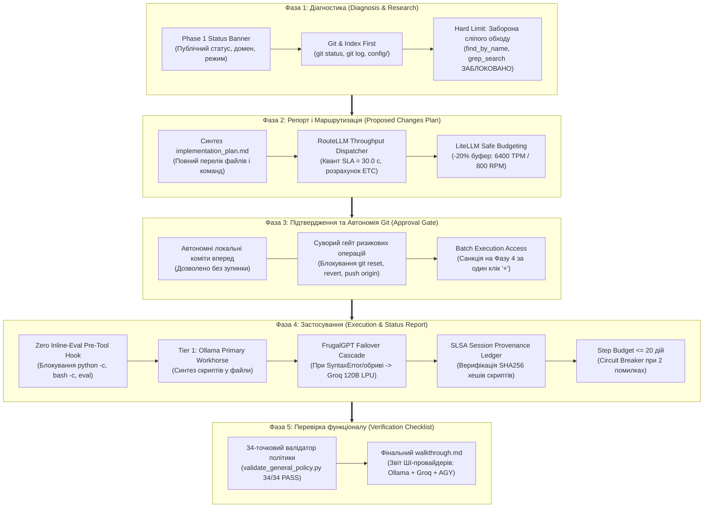
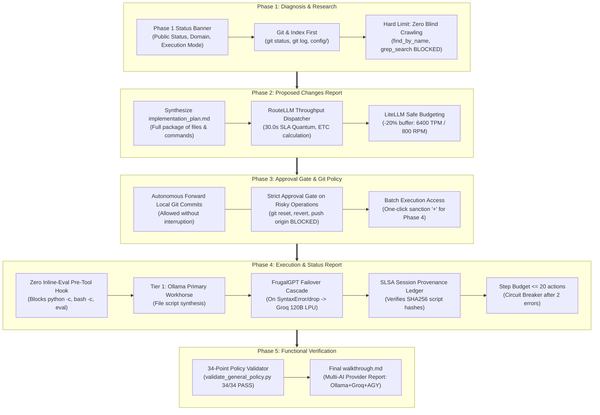

# 🚀 Hybrid Agentic IDE: Deterministic Multi-Tier AI Framework for Contributors

<p align="center">
  <a href="#-українська-версія"><b>🇺🇦 Українська версія</b></a> • 
  <a href="#-english-version"><b>🇬🇧 English Version</b></a>
</p>

<p align="center">
  <a href="https://www.python.org/downloads/"></a>
  <a href="https://opensource.org/licenses/MIT"></a>
  <a href="#"></a>
  <a href="#"></a>
  <a href="#"></a>
</p>

---

# 🇺🇦 Українська версія

> **Офіційне середовище розробки для контриб'юторів:** Надає можливість інженерам та спільноті за мінімальні кошти приєднатися до розробки та модифікації флагманського кіберфізичного проєкту **[fallaut4-STDFUA](https://github.com/sshill/fallaut4-STDFUA)** (українська локалізація, модифікації, низькорівнева телеметрія, Papyrus-скрипти).

---

## 1. 🎯 Ціль системи: Розробка за 0$ додаткових витрат на токени

Розробка складних систем із застосуванням комерційних ШІ-асистентів (Cursor, GitHub Copilot, платні API OpenAI/Anthropic) створює постійний фінансовий бар'єр для контриб'юторів у розмірі **$20–$300 щомісяця**.

**Hybrid Agentic IDE** кардинально розв'язує цю проблему через **гібридну 5-рівневу архітектуру**:
1. **Zero Marginal Token Cost:** Всі 100% рутинного кодингу, AST-перевірок, регулярних виразів та синтаксичного аналізу виконуються **повністю безкоштовно** локальною моделлю **Ollama** (`qwen2.5-coder:1.5b/3b/7b`) на звичайному процесорі лаптопа.
2. **Безкоштовний апаратний резерв (Groq LPU):** Для великих контекстів та складного синтезу залучається хмарний процесор LPU **Groq Cloud** (`openai/gpt-oss-120b`, `qwen/qwen3.8-27b`) зі швидкістю **460 токенів/с** у межах офіційного безкоштовного ліміту (14 400 RPD / 30 RPM).
3. **Безпека від витоку даних:** Первинний аналіз коду та файлів відбувається локально на машині розробника.

### 💰 Розрахунок Total Cost of Ownership (TCO):

| Компонент | Тип витрат | Вартість | Опис та роль у розробці |
| :--- | :---: | :---: | :--- |
| **Робоча станція / Ноутбук** | CAPEX (одноразово) | **29 000 грн** (~637 €) | Базовий ноутбук під керуванням **Debian 13 (Trixie) Linux** (16 ГБ RAM, Intel Core 3 100U / i5 / Ryzen 5). Дискретна GPU не потрібна. |
| **Мережевий інтернет** | OPEX (щомісячно) | **300 грн/міс** (~6.6 €) | Стабільний канал зв'язку для синхронізації з Git та звернень до Groq LPU. |
| **Ліцензія IDE** | Платформа | Комерційна ліцензія | **Google Antigravity** — перший за черговістю інтелектуальний оркестратор (Tier 0). |
| **Tier 1: Local Ollama** | Витрати на токени | **0.00 грн / 0.00 $** | Безлімітна локальна генерація на CPU лаптопа. |
| **Tier 2: Groq Cloud LPU** | Витрати на токени | **0.00 грн / 0.00 $** | 14 400 RPD безкоштовно під захистом квоти LiteLLM Safe Budget. |
| **Tier 3: Git Knowledge** | Витрати на токени | **0.00 грн / 0.00 $** | Кешування в `docs/knowledge/` ліквідує повторний веб-пошук. |

---

## 2. 🛡️ Двоконтурна система валідації (Two-Validator Governance)

Для гарантії надійності в репозиторії реалізовано розподілений контроль якості двома незалежними валідаторами:

```
┌────────────────────────────────────────────────────────────────────────┐
│  ВАЛІДАТОР 1: АНТІГРАВІТІ (ОРКЕСТРАТОР & ПЕРВИННИЙ КОНТРОЛЬ)            │
│  • Оцінка завдань користувача та побудова 5-фазного пайплайну           │
│  • Первинна фільтрація виводу моделей ШІ (Ollama / Groq)                │
│  • Автоматизований прогін 34 структурних правил регламенту (0.053 с)    │
│  • Формування звіту implementation_plan.md до першого байту змін        │
└───────────────────────────────────┬────────────────────────────────────┘
                                    │
                                    ▼
┌────────────────────────────────────────────────────────────────────────┐
│  ВАЛІДАТОР 2: CLAUDE SONNET (TIER 4 PRE-IMPLEMENTATION CODE-ARBITER)    │
│  • Офіційний релізний Code-Арбітраж ([CODE_AUDIT_REPORT])              │
│  • Суворий аудит перед виконанням плану та перед публікацією онлайн    │
│  • Перевірка відсутності архітектурних розривів (SEI/TOGAF Radar >=80%)│
│  • Аудит відповідності відкритим стандартам та нормам GitHub           │
└────────────────────────────────────────────────────────────────────────┘
```

---

## 3. 🔄 5-Фазний детерміністичний життєвий цикл (The 5-Phase Pipeline)



---

## 4. 🛡️ Інженерні челенджі та вирішені задачі на кожній фазі

| Фаза | Інженерний челендж (Risk / Anti-Pattern) | Реалізоване системне рішення (Best Practice) |
| :--- | :--- | :--- |
| **Фаза 1: Діагностика** | **Сліпий перебір дисків та спалювання токенів:** Модель рекурсивно сканує директорії, вичерпує контекст і формує галюцинації про проєкт. | **«Git & Index First»:** Дослідження починається виключно з `git status`, `git log` та готових JSON-маніфестів у `config/`. Публічний **Phase 1 Status Banner** фіксує контекст і унеможливлює приховані ланцюги викликів. |
| **Фаза 2: Репорт і План** | **Непрозорість дій та вичерпання квот:** Агент змінює код без попередження, а запити зависають або впираються в Rate Limits хмари. | **RouteLLM SLA Dispatcher (30с) + LiteLLM Safe Budget:** Автоматичний розрахунок часу виконання (ETC). Вивід $\le 60$ токенів скеровується на локальну Ollama, $> 60$ токенів — на швидкий Groq LPU із буфером $-20\%$ (6400 TPM, 800 RPM). `implementation_plan.md` формується до першого байту змін. |
| **Фаза 3: Підтвердження** | **Втрата накопиченого стану або випадковий пуш:** Ризик деструктивних відкатів (`git reset`), конфліктних злиттів чи передчасного надсилання коду на GitHub. | **Dual Git Policy:** Повна автономія для локальних комітів вперед (прогрес фіксується безперервно), але фізичне блокування `git reset`, `git revert`, `git merge`, `git push` без явної згоди розробника («+»). |
| **Фаза 4: Застосування** | **Неконтрольований інлайн-код та зациклення:** Виконання анонімного коду `python -c` чи `bash -c`, накопичення помилок синтаксису, збої раннера. | **Zero Inline-Eval Gate + FrugalGPT Cascade + SLSA Ledger:** OS-хук фізично блокує інлайн-код з кодом 126. Скрипти синтезуються у файли з реєстрацією SHA256. При помилці локальної моделі спрацьовує безшовний failover на Groq 120B. Бюджет кроків $\le 20$ дій, Circuit Breaker після 2 збоїв. |
| **Фаза 5: Перевірка** | **«Успіх за замовчуванням» (Assumed Success):** Звіт про успішне завершення без реального виконання тестів чи приховані збої провайдерів. | **34-точковий структурний валідатор + Multi-Provider Report:** Автоматичний запуск валідатора `validate_general_policy.py` (34/34 PASS), фіксація в `walkthrough.md` та відкритий вивід реальних віджетів інференсу всіх залучених моделей на екран чату. |

---

## 5. 🧩 Каталог модулів ядра (`core/` — Zero Dependencies)

Всі модулі написані на базі стандартної бібліотеки Python 3.10+ (без сторонніх `pip` залежностей):

* **[`core/engine/diagnostic_runner.py`](core/engine/diagnostic_runner.py)** — Уніфікована точка входу: перевірка моделей, безпечне підвантаження ключів з `~/.env`, FrugalGPT-каскад, апаратний ценз RAM ($\ge 6$ GB для 7B, заборона $\ge 14$B на локалі).
* **[`core/hooks/pre_tool_hook.py`](core/hooks/pre_tool_hook.py)** & **[`pre_tool_hook.sh`](core/hooks/pre_tool_hook.sh)** — OS-перехоплювач команд: блокує інлайн-код, деструктивні команди та контролює Step Budget.
* **[`core/router/phase2_router.py`](core/router/phase2_router.py)** — Динамічний диспетчер пропускної здатності RouteLLM (SLA 30 с) та контроль Safe Budget LiteLLM (-20%).
* **[`core/provenance/phase4_provenance.py`](core/provenance/phase4_provenance.py)** — Сесійний криптографічний реєстр походження коду рівня SLSA/in-toto з блокуванням `fcntl.flock`.
* **[`core/inspect/phase1_inspect.py`](core/inspect/phase1_inspect.py)** — Zero-dependency інспектор AST, JSON, XML та DOCX структур без сліпого обходу дисків.
* **[`core/verify/phase5_verify.py`](core/verify/phase5_verify.py)** — Портативний компілятор синтаксису Python та інтегратор фінального чек-листа.
* **[`core/verify/validate_general_policy.py`](core/verify/validate_general_policy.py)** — 34-точковий структурний валідатор відповідності регламенту v0.8.3.

---

## 6. ⚡ Швидкий старт для контриб'ютора на Debian 13

### Крок 1: Підготовка системи Debian 13 (Trixie) Linux
Встановіть базові системні інструменти та бібліотеки:
```bash
sudo apt update && sudo apt install -y python3 python3-pip git curl pulseaudio-utils alsa-utils
```

### Крок 2: Встановлення Google Antigravity та підключення Google AI Pro
> [!IMPORTANT]
> **Встановлення Google Antigravity та підключення ключа з власного акаунту Google AI Pro наполегливо рекомендовано!**  
> Обліковий запис **Google AI Pro** (через Google AI Studio) надає прямий доступ до найпотужнішого пулу моделей оркестрації (Tier 0: Gemini 3.8 Flash High) та релізного арбітражу (Tier 4: Claude Sonnet 5.5 / GPT-OSS 120B) з найвищим пріоритетом і без обмежень швидкості.

Додайте ключ `GEMINI_API_KEY` до захищеного конфігураційного файлу:
```bash
echo 'GEMINI_API_KEY="AIzaSy_ваш_ключ_google_ai_pro"' >> ~/.env
chmod 600 ~/.env
```

### Крок 3: Встановлення локальної Ollama (Tier 1 Primary Workhorse)
Для безкоштовного локального кодингу на процесорі лаптопа встановіть Ollama та завантажте рекомендовану надшвидку модель:
```bash
curl -fsSL https://ollama.com/install.sh | sh
ollama pull qwen2.5-coder:1.5b
```

### Крок 4: Клонування репозиторію та безкоштовний LPU-ключ
Клонуйте репозиторій та підключіть безкоштовний ключ Groq Cloud (14 400 RPD безкоштовно):
```bash
git clone https://github.com/sshill/Hybrid-IDE-for-contributirs.git
cd Hybrid-IDE-for-contributirs
echo 'GROQ_API_KEY="gsk_ваш_безкоштовний_ключ_groq"' >> ~/.env
```

### Крок 5: Автоматизований запуск скрипта валідації (`setup_and_verify.sh`)
Запустіть комплексний єдиний shell-скрипт, який перевіряє всю екосистему в 6 кроків:
```bash
./setup_and_verify.sh
```
Скрипт автоматично:
1. Перевіряє сумісність Debian 13.
2. Тестує наявність Python 3.10+, Git, Curl.
3. Перевіряє доступність локального демона Ollama на порті 11434.
4. Валідує наявність ключів `GEMINI_API_KEY` та `GROQ_API_KEY` у `~/.env`.
5. Проводить бойовий пре-флайт тест інференсу агентів Tier 1 + Tier 2.
6. Запускає системний валідатор 34 структурних правил регламенту (34/34 PASS).

---

## 7. 📜 Ліцензія

Проєкт розповсюджується під ліцензією **[MIT](LICENSE)**. Дозволяється вільне використання, модифікація та розширення в некомерційних і комерційних проєктах.

**Автор та системний архітектор:** Сергій Хилевич ([@sshill](https://github.com/sshill)).

---
---

# 🇬🇧 English Version

> **Official Contributor Development Environment:** Empowers software engineers and the community to join the development and modification of the flagship cyber-physical project **[fallaut4-STDFUA](https://github.com/sshill/fallaut4-STDFUA)** (Ukrainian localization, game mods, low-latency telemetry, Papyrus scripts) with minimal infrastructure expenses.

---

## 1. 🎯 Purpose: Engineering with Zero Marginal Token Cost

Developing complex systems with commercial AI tools (Cursor, GitHub Copilot, commercial OpenAI/Anthropic APIs) establishes a recurring financial barrier for contributors ranging from **$20 to $300/month**.

**Hybrid Agentic IDE** decisively resolves this barrier through a **Deterministic 5-Tier Hybrid AI Architecture**:
1. **Zero Marginal Token Cost:** 100% of routine coding, AST validation, regex parsing, and syntax checks are executed **completely free of charge** by a local **Ollama** engine (`qwen2.5-coder:1.5b/3b/7b`) running on a standard laptop CPU.
2. **Free Cloud Hardware Overflow (Groq LPU):** For larger contexts and complex code synthesis, the system dispatches to **Groq Cloud LPU** (`openai/gpt-oss-120b`, `qwen/qwen3.8-27b`) delivering **~460 tok/s** within the free tier quota (14,400 RPD / 30 RPM).
3. **Data Leakage Prevention:** Initial code diagnostics, repository indexing, and AST inspections are kept strictly offline on the developer's host machine.

### 💰 Contributor Total Cost of Ownership (TCO):

| Component | Cost Type | Amount (EUR / USD) | Operational Role |
| :--- | :---: | :---: | :--- |
| **Workstation / Laptop** | Hardware CAPEX (One-time) | **~€637 / ~$698** (29,000 UAH) | Standard laptop running **Debian 13 (Trixie) Linux** (16 GB RAM, Intel Core 3 100U / i5 / Ryzen 5). Dedicated GPU is NOT required. |
| **Internet Connection** | Network OPEX (Monthly) | **~€6.6 / ~$7.2** (300 UAH/mo) | Reliable network connection for Git synchronization and Groq LPU requests. |
| **IDE License** | Core Platform | Commercial License | **Google Antigravity** — operates as Tier 0 Orchestrator First. |
| **Tier 1: Local Ollama** | Token Consumption | **$0.00 / €0.00** | Unlimited local code generation on the laptop CPU. |
| **Tier 2: Groq Cloud LPU** | Token Consumption | **$0.00 / €0.00** | 14,400 RPD free tier guarded by LiteLLM Safe Budget. |
| **Tier 3: Git Knowledge** | Token Consumption | **$0.00 / €0.00** | Knowledge caching in `docs/knowledge/` prevents redundant web lookups. |

---

## 2. 🛡️ Two-Validator Governance Architecture

To guarantee code integrity and policy compliance, quality assurance is split between two independent validators:

```
┌────────────────────────────────────────────────────────────────────────┐
│  VALIDATOR 1: ANTIGRAVITY (ORCHESTRATOR & PRIMARY CONTROL)             │
│  • Task assessment and structured 5-phase lifecycle management         │
│  • Primary response validation of AI providers (Ollama / Groq)         │
│  • Automated verification of 34 structural policy rules (0.053 s)      │
│  • Synthesizes implementation_plan.md before any code modification     │
└───────────────────────────────────┬────────────────────────────────────┘
                                    │
                                    ▼
┌────────────────────────────────────────────────────────────────────────┐
│  VALIDATOR 2: CLAUDE SONNET (TIER 4 PRE-IMPLEMENTATION CODE-ARBITER)   │
│  • Official release code arbitration ([CODE_AUDIT_REPORT])             │
│  • Mandatory audit prior to plan execution and remote git push         │
│  • Architectural maturity verification (SEI/TOGAF Radar >= 80%)        │
│  • Open-source GitHub standards and repository integrity audit         │
└────────────────────────────────────────────────────────────────────────┘
```

---

## 3. 🔄 The 5-Phase Deterministic Pipeline



---

## 4. 🛡️ Engineering Challenges & Solved Tasks by Phase

| Phase | Engineering Challenge (Risk / Anti-Pattern) | Implemented System Solution (Best Practice) |
| :--- | :--- | :--- |
| **Phase 1: Diagnosis** | **Blind disk traversal & token exhaustion:** LLM recursively walks directories, depleting context window and producing repository hallucinations. | **«Git & Index First»:** Investigation strictly starts with `git status`, `git log`, and JSON index manifests in `config/`. Public **Phase 1 Status Banner** anchors context and prohibits silent loops. |
| **Phase 2: Proposed Plan** | **Opaque agent actions & quota exhaustion:** Agent mutates files unexpectedly; cloud requests time out or hit rate limits. | **RouteLLM SLA Dispatcher (30s) + LiteLLM Safe Budget:** Calculates Estimated Time to Completion (ETC). Outputs $\le 60$ tokens route to local Ollama; outputs $> 60$ tokens route to Groq LPU with a $-20\%$ safety buffer (6400 TPM, 800 RPM). `implementation_plan.md` created before editing a single byte. |
| **Phase 3: Approval Gate** | **Data loss or accidental remote push:** Destructive rollbacks (`git reset`), merge conflicts, or unauthorized pushes to GitHub. | **Dual Git Policy:** Full autonomy for local forward commits (preserves momentum), but physical blocking of `git reset`, `git revert`, `git merge`, and `git push` without explicit user sanction («+»). |
| **Phase 4: Execution** | **Unchecked inline scripts & runaway loops:** Executing anonymous `python -c` or `bash -c` snippets, syntax regressions, endless loops. | **Zero Inline-Eval Gate + FrugalGPT Cascade + SLSA Ledger:** OS hook physically blocks inline code with exit code 126. Scripts synthesized to files with SHA256 tracking. Local syntax errors trigger instant failover to Groq 120B. Step Budget limited to $\le 20$ calls; Circuit Breaker trips after 2 errors. |
| **Phase 5: Verification** | **Assumed correctness without test runs:** Agent falsely claims success without running tests or hides provider outages. | **34-Point Policy Validator + Multi-Provider Report:** Automated run of `validate_general_policy.py` (34/34 PASS), recorded in `walkthrough.md`, with real inference widgets displayed on screen. |

---

## 5. 🧩 Core Modules Catalog (`core/` — Zero Dependencies)

All modules are written in standard Python 3.10+ stdlib with zero external `pip` dependencies:

* **[`core/engine/diagnostic_runner.py`](core/engine/diagnostic_runner.py)** — Unified execution runner: provider check, FrugalGPT cascade, RAM bounds enforcement ($\ge 6$ GB for 7B, local prohibition of $\ge 14$B), credential loader.
* **[`core/hooks/pre_tool_hook.py`](core/hooks/pre_tool_hook.py)** & **[`pre_tool_hook.sh`](core/hooks/pre_tool_hook.sh)** — OS pre-tool hook interceptor: blocks inline code execution, prevents destructive Git commands, enforces Step Budget.
* **[`core/router/phase2_router.py`](core/router/phase2_router.py)** — Dynamic RouteLLM throughput dispatcher (30s SLA) and LiteLLM Safe Budget guard (-20%).
* **[`core/provenance/phase4_provenance.py`](core/provenance/phase4_provenance.py)** — SLSA/in-toto compliant session provenance ledger with atomic file locking (`fcntl.flock`).
* **[`core/inspect/phase1_inspect.py`](core/inspect/phase1_inspect.py)** — Zero-dependency structural inspector for AST, JSON, XML, and DOCX files.
* **[`core/verify/phase5_verify.py`](core/verify/phase5_verify.py)** — Portable Python syntax compiler and verification checklist runner.
* **[`core/verify/validate_general_policy.py`](core/verify/validate_general_policy.py)** — 34-point structural policy validator ensuring adherence to v0.8.3.

---

## 6. ⚡ Contributor Quickstart Guide on Debian 13

### Step 1: Debian 13 (Trixie) Linux Setup & Dependencies
Install system packages and core libraries:
```bash
sudo apt update && sudo apt install -y python3 python3-pip git curl pulseaudio-utils alsa-utils
```

### Step 2: Install Google Antigravity & Google AI Pro Key
> [!IMPORTANT]
> **Installing Google Antigravity and providing your Google AI Pro API key is strongly recommended!**  
> Having a **Google AI Pro** account (via Google AI Studio) ensures unrestricted access to the premier model pool (Tier 0 Orchestrator: Gemini 3.8 Flash High) and release auditing models (Tier 4 Arbiter: Claude Sonnet 5.5 / GPT-OSS 120B) with top throughput and zero throttling.

Add your `GEMINI_API_KEY` to the secure environment configuration:
```bash
echo 'GEMINI_API_KEY="AIzaSy_your_google_ai_pro_key"' >> ~/.env
chmod 600 ~/.env
```

### Step 3: Install Local Ollama (Tier 1 Primary Workhorse)
For 100% free offline CPU inference on your laptop, install Ollama and pull the recommended high-speed coding model:
```bash
curl -fsSL https://ollama.com/install.sh | sh
ollama pull qwen2.5-coder:1.5b
```

### Step 4: Clone the Repository & Configure Free Groq LPU Key
Clone the repository and supply your free Groq Cloud key (14,400 RPD free tier):
```bash
git clone https://github.com/sshill/Hybrid-IDE-for-contributirs.git
cd Hybrid-IDE-for-contributirs
echo 'GROQ_API_KEY="gsk_your_free_groq_key"' >> ~/.env
```

### Step 5: Run Automated Validation Script (`setup_and_verify.sh`)
Execute the unified shell script to validate your environment end-to-end:
```bash
./setup_and_verify.sh
```
The script automatically:
1. Verifies Debian 13 system compatibility.
2. Asserts Python 3.10+, Git, and Curl availability.
3. Checks local Ollama service status on port 11434.
4. Validates `GEMINI_API_KEY` and `GROQ_API_KEY` presence in `~/.env`.
5. Executes pre-flight AI inference tests (Tier 1 Ollama + Tier 2 Groq LPU).
6. Executes the 34-point General Execution Policy validator (34/34 PASS).

---

## 7. 📜 License

This project is licensed under the **[MIT License](LICENSE)**. Unrestricted commercial and non-commercial use, modification, and distribution are permitted.

**Author & Principal Systems Architect:** Serhii Khylevych ([@sshill](https://github.com/sshill)).
