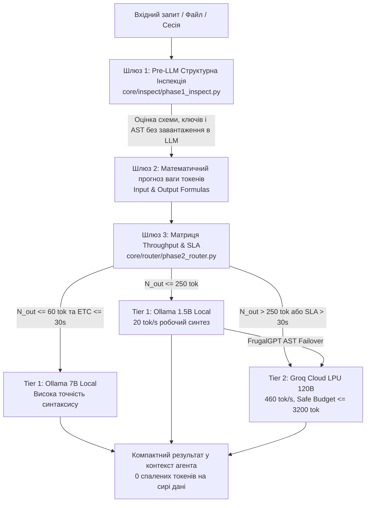

# 🌐 Open-Source Референси з GitHub: Індустріальні Моделі Маршрутизації (v0.9.0)

Цей документ фіксує перелік та аналіз оригінальних відкритих проєктів і фреймворків із GitHub, архітектурні принципи яких було досліджено та адаптовано у вигляді легковажних zero-dependency модулів у репозиторії **`Hybrid-IDE-for-contributors`**.

---

## 1. Досліджені відкриті проєкти з GitHub

| Проєкт / Організація | Репозиторій на GitHub | Ключова концепція | Що запозичено в Hybrid IDE |
| :--- | :--- | :--- | :--- |
| **`RouteLLM`**<br>(LMSYS / UC Berkeley) | [github.com/lm-sys/RouteLLM](https://github.com/lm-sys/RouteLLM) | Оцінка складності запитів (Threshold Router, Matrix Factorization) для оптимізації вартості між слабкою моделлю (7B) та сильною моделлю (120B/Claude). | Формула Throughput / SLA розрахунку очікуваного часу ($\text{ETC}$) у [`core/router/phase2_router.py`](../../core/router/phase2_router.py): автоматичний вибір моделі на основі квоти виводу токенів при SLA $\le 30.0$ с. |
| **`LiteLLM Router`**<br>(BerriAI) | [github.com/BerriAI/litellm](https://github.com/BerriAI/litellm) | Уніфіковане проксі з відстеженням рейт-лімітів (RPM/TPM), чергами запитів та динамічним бюджетом. | Концепція **LiteLLM Safe Budgeting (-20% Margin)**: жорсткий поріг 6400 TPM / 800 RPM / макс. 3200 токенів на вивід для Groq Cloud LPU для захисту від блокувань API `429 Too Many Requests`. |
| **`FrugalGPT`**<br>(Stanford University) | [arxiv.org/abs/2305.05176](https://arxiv.org/abs/2305.05176) | Каскадна маршрутизація (LLM Cascade): запит спочатку надсилається дешевій моделі, якість відповіді валідується, і лише при помилці ескалюється до дорогої моделі. | **FrugalGPT Failover Cascade** у [`core/engine/diagnostic_runner.py`](../../core/engine/diagnostic_runner.py): синтаксична AST-валідація коду локальної Ollama (`ast.parse()`); при `SyntaxError` чи збої сокета — автоматична ескалація на Groq LPU 120B з точною перевіркою `raw_cloud.startswith("ERROR:")`. |
| **`Semantic Router`**<br>(Aurelio Labs) | [github.com/aurelio-labs/semantic-router](https://github.com/aurelio-labs/semantic-router) | Надшвидка семантична класифікація намірів без звернення до важких LLM (нульова затримка). | Евристичний розрахунок маршруту в чистому Python stdlib без додаткових викликів мережі ($< 5$ мс на прийняття рішення). |

---

## 2. Реалізація у коді Hybrid IDE: Математична модель прогнозування ваги токена

Усі принципи реалізовано **без важких сторонніх залежностей (Zero-Dep Python 3.10+ stdlib)** для забезпечення миттєвого старту на будь-якому дистрибутиві Linux без `pip install`.



### 2.1 Формула оцінки ваги вхідного промпта (Prompt Token Weight)
У [`core/engine/diagnostic_runner.py`](../../core/engine/diagnostic_runner.py):
$$\text{Prompt Tokens} = \text{int}(\text{len}(\text{task\_prompt.split}()) \times 1.3) + 150$$

- **`task_prompt.split()`**: токенізація на рівні слів без сторонніх важких бібліотек (`tiktoken`).
- **Мультиплікатор $1.3$**: емпіричний субворд-коефіцієнт BPE/WordPiece для технічної англійської/української мови та синтаксису коду Python.
- **Константа $+ 150$**: системний оверхед фреймінгу інструкцій кондуктора (`full_prompt` у `synthesize_script_file`).
- **Для файлових зрізів (`--ollama-file`)**: додається вага вилученого зрізу файлу:
  $$\text{Prompt Tokens} = \text{int}((\text{len}(\text{prompt.split}()) + \text{len}(\text{file\_slice.split}())) \times 1.3) + 150$$

### 2.2 Модель пропускної здатності та розрахунок часу завершення (Throughput Model & ETC)
У [`core/router/phase2_router.py`](../../core/router/phase2_router.py):
$$\text{ETC}(\text{model}) = \text{TTFT} + \frac{N_{\text{out}}}{V_{\text{model}}}$$

Фізичні характеристики моделей на апаратному стенді (Intel Core 3 100U / 16 ГБ RAM):
| Модель | $V_{\text{model}}$ (Throughput) | $\text{TTFT}$ (First Token) | Споживання RAM | Рівень архітектури |
| :--- | :---: | :---: | :---: | :--- |
| `qwen2.5-coder:1.5b` | **20.0 tok/s** | 0.3 с | 1.2 ГБ | Tier 1 Local Edge |
| `qwen2.5-coder:3b` | **10.0 tok/s** | 0.6 с | 2.2 ГБ | Tier 1 Local Edge |
| `qwen2.5-coder:7b` | **2.8 tok/s** | 1.8 с | 5.1 ГБ ($\ge 6.0$ ГБ вільної RAM) | Tier 1 Local Edge |
| `openai/gpt-oss-120b` | **460.0 tok/s** | 0.2 с | 0.0 ГБ (Cloud LPU) | Tier 2 Groq Cloud |

### 2.3 Детерміністичні пороги маршрутизації (Decision Thresholds)
1. **Ескалація на Groq LPU 120B (Tier 2):**
   $$\text{Якщо } (N_{\text{out}} > 250) \lor (\text{Prompt Tokens} > 3000) \lor (\text{ETC}_{7B} > \text{SLA}_{30\text{s}}) \implies \text{Tier 2 Groq LPU}$$
   *Приклад:* Генерація $400$ токенів на 7B займе: $1.8 + \frac{400}{2.8} = \mathbf{144.66\text{ с}}$ (перевищення SLA у 4.8 раза). На Groq LPU 120B це займе: $0.2 + \frac{400}{460} = \mathbf{1.07\text{ с}}$.
2. **Високоточний локальний синтаксис 7B (Tier 1):**
   $$\text{Якщо } (N_{\text{out}} \le 60) \land (\text{ETC}_{7B} \le 30.0\text{ с}) \implies \text{Tier 1 Ollama 7B}$$
   $$\text{ETC}_{7B} = 1.8 + \frac{60}{2.8} = \mathbf{23.2\text{ с}} \le 30.0\text{ с (висока точність без виходу в інтернет)}.$$
3. **Робочий синтез 1.5B (Tier 1):**
   $$\text{Якщо } (N_{\text{out}} \le 250) \implies \text{Tier 1 Ollama 1.5B}$$
   $$\text{ETC}_{1.5B} = 0.3 + \frac{250}{20} = \mathbf{12.8\text{ с}} \le 30.0\text{ с (швидко та економно за RAM)}.$$

### 2.4 LiteLLM Safe Budgeting (-20% Margin)
- Номінальні квоти безкоштовного API Groq: 8,000 TPM / 1,000 RPM / ліміт вікна 4,096 токенів.
- **Безпечний коридор (-20%):**
  $$\text{Safe TPM} = 8,000 \times 0.8 = \mathbf{6,400\text{ TPM}}$$
  $$\text{Safe RPM} = 1,000 \times 0.8 = \mathbf{800\text{ RPM}}$$
  $$\text{Max Single Out} = 4,096 \times 0.8 \approx \mathbf{3,200\text{ токенів}}$$

### 2.5 Адаптивний таймаут сокета HTTP
Замість жорстких зависань на 90 с:
$$\text{Timeout}_{\text{adaptive}} = \max(30, \text{int}(1.5 \times \text{ETC}) + 10)$$

---

## 3. Допоміжні zero-dependency фільтри перед LLM

1. **[`core/inspect/phase1_inspect.py`](../../core/inspect/phase1_inspect.py)** — пре-флайт інспектор форматів:
   - `--json`: парсить ключі, схеми та розмірності (`Array[1225]`, `Dict[14 keys]`) без завантаження 15 МБ у пам'ять моделі.
   - `--ast`: статично витягує класи та сигнатури функцій без запуску інтерпретатора.
   - `--docx` / `--xml`: безпечно вилучає параграфи й коментарі без entity expansion та без MS Word / LibreOffice.
2. **`inspect_session.py`** — потоковий аналіз транскриптів сесій: витягує кроки, збої та події компакції (`truncated_fields > 0`) навіть із файлів на 15+ МБ (як у сесії `ee6e8ead` на 1225 кроків).

---

## 4. Як сторонньому розробнику отримати доступ

1. **Локальні моделі:**
   ```bash
   ollama pull qwen2.5-coder:1.5b
   ollama pull qwen2.5-coder:7b
   ```
2. **Хмарний LPU (Groq):**
   - Безкоштовний акаунт на [console.groq.com](https://console.groq.com)
   - Додати ключ у `~/.env`:
     ```bash
     echo 'GROQ_API_KEY="gsk_..."' >> ~/.env
     ```
3. **Запуск валідації:**
   ```bash
   ./setup_and_verify.sh
   ```

👉 Докладний емпіричний аналіз та кейс-стаді див. у **[`PoC/case_study_session_ee6e8ead_longevity.md`](../../PoC/case_study_session_ee6e8ead_longevity.md)**.
